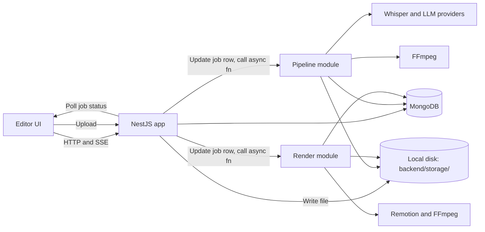
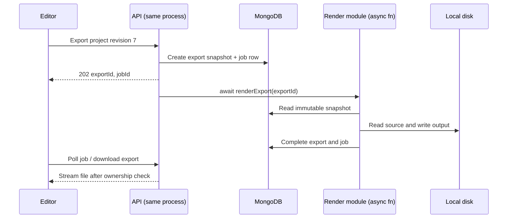

# AI video editor: proposed backend architecture

This is a design document based on [Readme.md](Readme.md). It proposes a
single-process NestJS monolith with local filesystem storage for now. It does
not implement these services or change the current application.

See [schema.md](schema.md) for collections, fields, relationships, and indexes.

## Current implementation and proposed design

The current backend is one NestJS app. `common/mongodb/monogo.ts` creates a
MongoDB client, and `restapi.controller.ts` connects on startup and closes it on
shutdown. `/restapi/health/db` tests connectivity. Keep this working setup.

No cloud and no microservices for now: one deployable process, one codebase
root (`backend/`), local disk for uploaded/processed video instead of S3/R2.
Split into separate services (API/pipeline/render) and move storage to an
object store (R2/S3) later, if/when scale requires it — the module boundaries
below are kept so that split stays straightforward, but nothing is deployed
separately today.

## Module boundaries (within one process)

Everything below runs in the same NestJS app and the same Node process. The
boundaries are module/folder boundaries, not deployment boundaries.

| Module          | Responsibility                                                                               |
| --------------- | -------------------------------------------------------------------------------------------- |
| API controllers | Auth, teams, billing/credits, uploads, projects, editor saves, job status, downloads         |
| Pipeline module | Media preparation, transcription, AI planning (cuts, captions, stickers, template, assemble) |
| Render module   | Load frozen export plan, Remotion/FFmpeg render, write result to local disk                  |

No Redis and no job queue library either, for now. Background work
(transcription, planning, rendering) runs as a plain async function call
kicked off from the controller and tracked with a `jobs` row the API writes
to as it progresses (`status`, `stage`, `error`) — no queue, no broker,
nothing to run alongside the Node process. The editor polls
`GET /jobs/:id` to watch progress. This is the simplest thing that works
locally; add a real queue later only if a single Node process stops being
enough (e.g. you need retries across restarts or multiple workers).



## Local storage layout

Uploaded and generated files live under a single root directory on disk,
configured once (e.g. `STORAGE_ROOT=./storage`), mirroring the object-storage
"key" concept so the move to a bucket later is a adapter swap, not a schema
change:

```text
backend/storage/
├── uploads/{teamId}/{mediaId}/original.<ext>   # raw uploaded video
├── derived/{teamId}/{mediaId}/proxy.mp4         # pipeline-prepared proxy/audio
├── stickers/{stickerKey}.<ext>                  # bundled static sticker/emoji assets
└── exports/{teamId}/{exportId}/output.mp4       # render service output
```

`media.storage_key` (see [schema.md](schema.md)) stores the path relative to
`STORAGE_ROOT`, e.g. `uploads/665.../665.../original.mp4` — the same shape an
object-storage key would have. A small `storage` module exposes
`save(key, stream)`, `read(key)`, and `signedUrlFor(key)` (for local files,
this can just be a short-lived signed API route like
`GET /files/:key?sig=...` rather than a real pre-signed URL) so the rest of
the app never touches `fs` directly, and swapping to R2/S3 later means
rewriting only that module.

## Upload flow (no signed cloud URL)

Since there is no bucket yet, uploads go straight through the API instead of
a signed direct-to-bucket URL:

1. `POST /api/v1/teams/:teamId/uploads` — multipart upload handled by the API
   (e.g. Nest's `FileInterceptor`), streamed to
   `storage/uploads/{teamId}/{mediaId}/original.<ext>`. Validate size and
   mime type before/while writing; reject and clean up partial files on
   failure.
2. API creates the `media` row (`status: "ready"` once the write completes;
   `duration_ms` filled in by a quick ffprobe call) and returns `mediaId`.
3. `POST /api/v1/teams/:teamId/projects` references that `mediaId`, creates
   the project, and enqueues the pipeline job as before.

No `uploads/sign` / `uploads/complete` split is needed while storage is
local — that pattern is for when the browser uploads directly to a bucket.
Keep the route names generic (`/uploads`) so adding a signed-URL path later
doesn't rename anything the editor already calls.

## Database ownership

One process, one MongoDB database — there's no ownership split to design
yet. Keep collections exactly as in [schema.md](schema.md); the module table
above is the only separation that exists today.

## Team context and billing

Each team has an independent `teams._id`, used as `teamId` in resources and
queue messages; different from `users._id`. Billing settings and the credit
balance live inside `teams.billing`, scoped to that team.

For team resource routes, use `/api/v1/teams/:teamId` as the prefix. The API
validates the requesting user against the team's `owner_id` before accessing
data. Users/sessions and global style/sticker catalog routes remain outside
this prefix.

When charging work, debit the selected team's balance and write a ledger
entry with that same `teamId`. Refunds credit the original charged team.

## Request flow: upload and AI planning

1. User logs in, obtains an access token, and selects a team. API verifies ownership/access.
2. `POST /api/v1/teams/:teamId/uploads` streams the file to local disk (see
   Upload flow above) and creates the `media` row.
3. `POST /api/v1/teams/:teamId/projects` verifies the media belongs to the
   team, creates the project, reserves credits if required, creates a `jobs`
   row (`status: "running"`), and calls the pipeline function — fire-and-await
   or fire-and-forget, not queued. Return HTTP 202 with `projectId` and `jobId`
   immediately; the pipeline keeps running and updates the job row as it goes.
4. The pipeline module runs the planning steps in order: prepare proxy/audio → transcribe → detect
   cuts → generate captions → classify sticker moments (matched against the
   `stickers` catalog's `tags`) → pick a template (from the `styles` catalog)
   → assemble and validate the edit plan → save. Progress describes the
   current stage.
5. Save only if the project revision and active pipeline job still match the
   original request. A stale pipeline must not overwrite newer edits.
6. API exposes progress through polling first, then SSE when implemented.

## Request flow: editor saves and exports

1. `GET /api/v1/teams/:teamId/projects/:id` returns the edit plan and current revision.
2. Editor submits `PUT /api/v1/teams/:teamId/projects/:id` with `expectedRevision` and the plan.
3. API validates the plan and conditionally updates using `_id`, `teamId`, and
   `revision`. Increment revision on success; return HTTP 409 for a stale save.
4. `POST /api/v1/teams/:teamId/projects/:id/export` freezes the selected plan
   revision into an export document, creates a `jobs` row, and calls the
   render function the same way (no queue).
5. The render module reads that immutable snapshot, resolves local media file
   paths, runs the same Remotion composition the editor previews with, writes
   the result to `storage/exports/{teamId}/{exportId}/output.mp4`, and
   records completion. It never renders the mutable live project plan.
6. `GET /api/v1/teams/:teamId/exports/:id/download` checks ownership and
   completion, then streams the file (or returns a short-lived signed
   `/files/:key` URL as described in Local storage layout above).



## Job records (no queue payloads)

There's no queue, so there's no message schema to version — just the `jobs`
row itself (see `schema.md`). The API writes it before calling the pipeline
or render function directly, and that function updates `stage`/`status`/
`error` as it runs:

| Job kind   | Progress stages (`jobs.stage`)                                      |
| ---------- | --------------------------------------------------------------------- |
| `pipeline` | prepare → transcribe → cuts → captions → stickers → template → save |
| `render`   | load snapshot → render → write file → complete                      |

A process restart mid-job leaves that job's row stuck at a non-terminal
`status: "running"` — on startup, sweep `jobs` for stale `running` rows older
than a timeout and mark them `failed` so the editor isn't left polling
forever; the user can retry. Invalid inputs fail immediately with a clear
`error`. Check a `cancelRequested` flag between stages; cancellation during
FFmpeg/Remotion also requires terminating the active child process and
cleaning temp files.

## Planned API groups

Identity, team discovery, global styles/stickers, and health use `/api/v1`.
Team resource routes in the table below use `/api/v1/teams/:teamId` plus the
listed path. Every team resource route requires a valid team context and
team-scoped queries. Auth registration/login and basic liveness are exceptions.

| Group       | Routes                                                                               | Purpose                                                                        |
| ----------- | ------------------------------------------------------------------------------------ | ------------------------------------------------------------------------------ |
| Auth        | `POST /auth/register`, `/auth/login`, `/auth/refresh`; `GET /auth/me`                | Identity and token lifecycle                                                   |
| Users       | `GET/PATCH /users/me`                                                                | Global user profile                                                            |
| Teams       | `POST /api/v1/teams`; `GET /api/v1/teams`; `GET/PATCH /api/v1/teams/:teamId`         | Create, list, and manage teams                                                 |
| Billing     | `GET /billing`, `/billing/credits`; `POST /billing/checkout`, `/billing/portal`      | Selected team's billing                                                        |
| Uploads     | `POST /uploads`; `DELETE /uploads/:id`                                               | File lifecycle (local disk for now)                                            |
| Projects    | `POST /projects`; `GET /projects`, `/projects/:id`; `PUT/PATCH/DELETE /projects/:id` | Project and editor operations                                                  |
| AI          | `POST /projects/:id/regenerate`, `/prompt`, `/restyle`                               | Queue new planning revisions (whole plan or a single step, e.g. stickers only) |
| Transcripts | `GET/PUT /projects/:id/transcript`                                                   | Caption text editing                                                           |
| Styles      | `GET /styles`, `/styles/:id`                                                         | Template catalog                                                               |
| Stickers    | `GET /stickers`, `/stickers/:id`                                                     | Sticker/emoji catalog                                                          |
| Exports     | `POST /projects/:id/export`; `GET /projects/:id/exports`, `/exports/:id/download`    | Render and delivery                                                            |
| Jobs        | `GET /jobs/:id`, `/jobs/:id/events`; `POST /jobs/:id/cancel`                         | Progress and cancellation                                                      |
| Files       | `GET /files/:key`                                                                    | Signed local-file read (uploads, exports, stickers)                            |
| Health      | `GET /health/live`, `/health/ready`                                                  | Process liveness and dependency readiness                                      |

Provider webhooks use `/api/v1/billing/webhooks/:provider`. They use provider
signature authentication and resolve the team from stored provider IDs. Do
not trust an arbitrary `teamId` from an unverified event.

Health implementation must distinguish a running process from one ready to
serve requests. The existing `/restapi/health/db` remains the current
implemented check.

## Folder structure (single app)

```text
backend/
├── src/
│   ├── main.ts
│   ├── app.module.ts
│   ├── common/
│   │   ├── mongodb/
│   │   │   ├── monogo.ts                  # client factory; one client for the process
│   │   │   ├── collections.ts             # typed collection access
│   │   │   ├── indexes.ts
│   │   │   └── schemas/
│   │   │       ├── base.schema.ts
│   │   │       ├── team.schema.ts
│   │   │       ├── user.schema.ts
│   │   │       ├── session.schema.ts
│   │   │       ├── credit-transaction.schema.ts
│   │   │       ├── media.schema.ts
│   │   │       ├── project.schema.ts
│   │   │       ├── job.schema.ts
│   │   │       ├── export.schema.ts
│   │   │       ├── style.schema.ts
│   │   │       ├── sticker.schema.ts
│   │   │       └── index.ts
│   │   ├── storage/                       # local-disk save/read/signed-url adapter
│   │   ├── edit-plan/                     # EditPlan zod schema + types
│   │   ├── jobs/                          # jobs collection read/write helpers (no queue)
│   │   ├── config/                        # validated settings
│   │   └── guards/                        # authentication and ownership
│   ├── restapi/
│   │   ├── restapi.controller.ts          # startup connection and health
│   │   ├── auth.controller.ts
│   │   ├── teams.controller.ts
│   │   ├── billing.controller.ts
│   │   ├── users.controller.ts
│   │   ├── uploads.controller.ts
│   │   ├── projects.controller.ts
│   │   ├── jobs.controller.ts
│   │   ├── exports.controller.ts
│   │   └── files.controller.ts
│   ├── pipeline/
│   │   ├── run-pipeline.ts                # orchestrates the steps below, called directly
│   │   ├── media/prepare-media.ts
│   │   ├── transcription/transcribe.ts
│   │   └── planning/
│   │       ├── detect-cuts.ts
│   │       ├── generate-captions.ts
│   │       ├── classify-stickers.ts
│   │       ├── pick-template.ts
│   │       ├── generate-plan.ts
│   │       └── prompts/
│   └── render/
│       ├── run-render.ts                  # orchestrates render, called directly
│       ├── render-video.ts
│       └── remotion/
│           ├── root.tsx
│           ├── compositions/
│           ├── components/
│           └── styles/
├── storage/                                # local upload/derived/export files (gitignored)
├── scripts/                                # indexes and style/sticker seed commands
├── test/
└── .env.example
```

Keep controllers small: validate input, identify the user, call an operation,
and return its result. The editor and renderer consume the same validated
edit-plan format (see the `timeline_json` schema in [schema.md](schema.md)).

## Configuration and lifecycle

| Settings                                  | Used by                                     |
| ----------------------------------------- | ------------------------------------------- |
| `MONGODB_URI`, `MONGODB_DATABASE`         | Database connection                         |
| `STORAGE_ROOT`                            | Local disk root for uploads/derived/exports |
| `PORT`, JWT signing/verification settings | API                                         |
| Groq/Gemini keys or local Whisper URL     | Pipeline module                             |
| FFmpeg path and temporary directory       | Pipeline and render modules                 |

Validate configuration at startup, never expose secrets to the browser, and
stop accepting work before closing the MongoDB client and any in-flight child
processes during shutdown.

## Implementation order

1. Add document definitions, runtime validators, indexes, and style/sticker seeds.
2. Implement authentication, teams, and team-scoped upload (local disk) and project operations.
3. Add team billing/credits and a simple `jobs` collection (status/stage tracking, no queue).
4. Add FFmpeg, transcription, and the split planning steps (cuts, captions,
   sticker classification, template selection); validate generated plans.
5. Implement versioned editor saves and frozen export snapshots.
6. Add Remotion render and local-file output delivery.
7. Add SSE, cancellation, retries, cleanup.
8. (Later, only if needed) Move storage to R2/S3 and split pipeline/render
   into separate deployed processes — the module boundaries above are kept
   deliberately so this is an adapter swap, not a rewrite.

Validate each boundary with integration tests. Test duplicate jobs, stale
saves, provider failures, cancellation, immutable exports, and cross-team
access denial.
